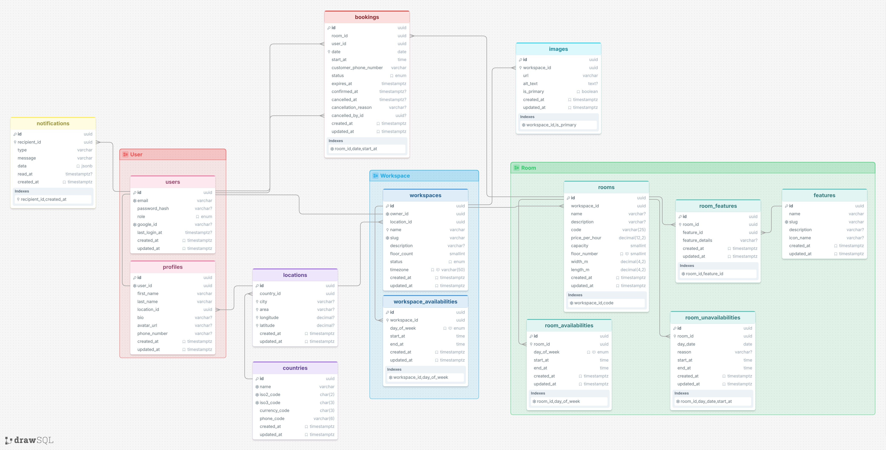

# FindSpace API

Backend API for **FindSpace**, a marketplace where customers find and book rooms in workspaces. Workspace owners manage their workspaces, rooms, availability, and bookings.

## Domain

FindSpace helps customers find rooms in a selected country and book fixed one-hour time slots.

### Actors

- **Customer** — finds rooms, manages their account, and books rooms.
- **Workspace Owner** — manages workspaces, rooms, availability, and bookings.
- **Admin** — manages users, workspaces, rooms, and bookings.

## Core Booking Flow

1. Customer chooses a country and finds a room.
   - If the customer's profile has a country, it is selected by default.
   - Otherwise, the customer must choose a country.
   - This choice is not saved as the customer's profile country.
2. Customer books a fixed one-hour time slot and provides a phone number.
3. The booking starts with `pending` status.
4. The pending booking holds the time slot.
5. The workspace owner contacts the customer by phone or WhatsApp.
6. The owner confirms or cancels the booking in the app.
   - The owner must give a reason when cancelling.
7. If the booking is not confirmed, it is automatically cancelled at the earlier of 20 minutes after creation or the booking's start time.
8. A cancelled booking no longer holds the time slot.

## Current Status

🚧 **In development**

This project is part of a full-stack learning roadmap. It focuses on planning requirements, data, and system design before implementation.

## Development Setup

### Requirements

- Node.js 22.12 or newer
- pnpm

### Install

```bash
pnpm install
cp .env.example .env
```

### Run locally

```bash
pnpm dev
```

The API runs on the port set by `PORT` (default: `3000`).

### Available Scripts

- `pnpm dev` — Start the development server.
- `pnpm build` — Build the production server.
- `pnpm start` — Run the production build.
- `pnpm typecheck` — Check TypeScript.
- `pnpm test` — Run tests.
- `pnpm test:watch` — Run tests in watch mode.

### Health Check

```text
GET /health
```

Returns a simple status response to check that the server is running.

### Environment Variables

- `NODE_ENV` — Runtime environment.
- `PORT` — Server port.

## Documentation

- [`Requirements`](docs/requirements.md) — User stories, booking rules, and v1 scope.
- [`ERD (Mermaid)`](docs/erd.md) — Database entities and relationships.
- [`See ERD on drawsql.app`](https://drawsql.app/teams/farghali/diagrams/findspace)
- [`API Surface`](docs/api-surface.md)
- [`API Contract`](docs/api-contract.md)
- [`Brief`](docs/brief.md)

## ERD



## Planned Scope

The v1 platform will support:

- Room discovery and search by location or workspace name
- Country selection
- Filtering by time, capacity, and features
- Sorting rooms by price
- Room details
- Customer and workspace owner accounts (email/password or Google)
- Profile editing and profile images
- Workspace and room management
- Workspace and room availability settings
- Booking creation, viewing, cancellation, and owner confirmation
- Saved notifications for booking updates and reminders
- Arabic and English language support

### Out of Scope for v1

- Payments
- Reviews and ratings
- Recurring bookings
- Customer-owner messaging inside the platform
- Discounts
- Real-time notifications
